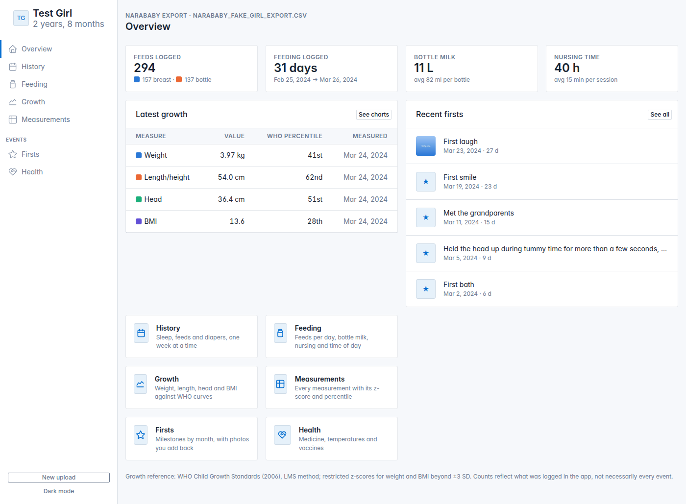
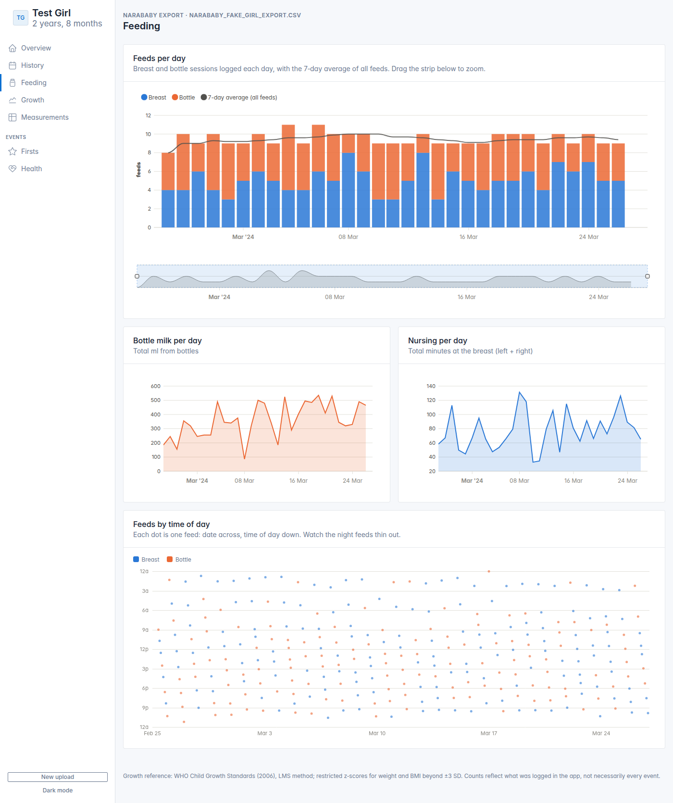

# Babygraph

Turn your baby tracker export into charts and timelines. Supports NaraBaby CSV exports.
Runs in your browser; nothing is uploaded.

## Why

NaraBaby started charging, and without a subscription your account goes read-only. You can still
export your data as a CSV, but it's one wide, unstructured spreadsheet: every entry type shares the
same rows, units are mixed, and photos aren't included.

This parses that export and shows the data you've been logging, instead of leaving it as an idle backup.

## Screenshots

From the fake test export (`fixtures/narababy_fake_girl_export.csv`). Every section is in
[`docs/screenshots/`](docs/screenshots/); regenerate them with `npm run screenshots`.




## What it shows

- **Overview**: totals, the latest growth percentiles and recent Baby Firsts.
- **History**: one week at a time, with sleep, feeds and diapers on a 24-hour grid plus daily totals.
- **Feeding**: feeds per day with a 7-day average, bottle milk and nursing minutes, and a
  time-of-day scatter showing the night feeds thin out. The timeline zooms.
- **Growth**: weight, length/height, head circumference and BMI against the
  [WHO Child Growth Standards](https://www.who.int/tools/child-growth-standards), plus a chart of
  how each percentile has tracked.
- **Measurements**: every measurement with its z-score and percentile.
- **Firsts**: Baby Firsts month by month. The export drops photos, so you can add them back here.
- **Health**: medicine doses (with the time since the previous dose), temperatures with fever
  flags, and vaccine visits.

Health is a record of what was logged, not medical advice.

## Privacy

Everything happens in your browser. The CSV is parsed on your device and kept in `localStorage`,
and any photos you add are stored in IndexedDB. Nothing is uploaded, and there's no backend. That
also means the data lives only in that browser: clearing site data or switching browsers means
uploading the export again, and photos you added need re-adding, so keep your originals.

Real exports are never committed: `.gitignore` excludes `export_narababy_*.csv`.

## Running it

Needs Node 20.19+ or 22.12+ (what Vite 8 requires).

```sh
npm install
npm run dev       # local dev server
npm run build     # static site in dist/
npm run preview   # serve the built site
npm test          # importer tests against the fake fixtures
npm run e2e       # build, then browser tests in headless Chromium
```

The browser tests (`e2e/`) start their own preview server and use the fake exports in `fixtures/`.
They need a Chromium: run `npx playwright-core install chromium` once, or point `CHROME_PATH` at one.
To also check your own export, which is never committed, run:

```sh
BABYGRAPH_EXPORT=/path/to/export_narababy_<name>_<date>.csv npm run e2e
```

That suite compares the page against what the parser reads from your file, so it works with any export.

`dist/` is plain static files, so it can be hosted anywhere, such as GitHub Pages. Serve it rather than
opening it from disk: some browsers give `file://` pages separate storage.

## Project layout

- `index.html` + `src/Landing.vue`: upload page.
- `dashboard.html` + `src/App.vue`: sidebar dashboard, one section at a time (`src/sections/`).
- `src/lib/importer.js`: parses the NaraBaby CSV into the dashboard's data shape.
- `src/lib/who.js`, `src/lib/growth.js`: WHO LMS z-scores and percentiles; tables in `src/data/who_lms.json`.
- `src/lib/photos.js`: IndexedDB storage for photos added to Baby Firsts.
- `fixtures/`: two fake exports (a girl and a boy, one month each), their expected parser output, and a test photo.
- `tests/`: importer unit tests. `e2e/`: browser tests.
- `PLAN.md`: design decisions and test results.

## License

MIT, see `LICENSE`. Third-party code and data are listed in `NOTICE.md`, including the WHO growth tables
and their source. The built site also includes `THIRD-PARTY-LICENSES.md` with every bundled package's license.

Unofficial; not affiliated with NaraBaby.
